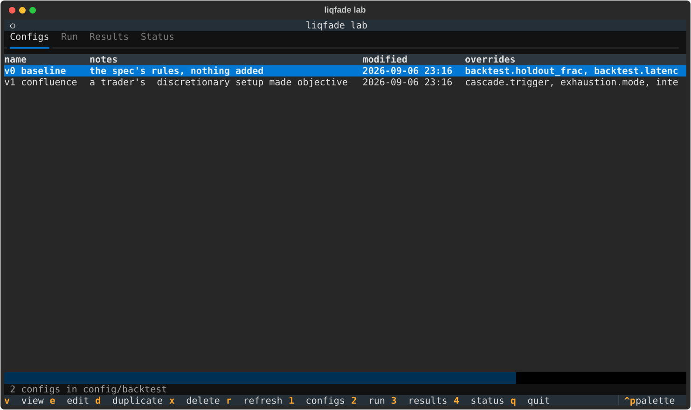
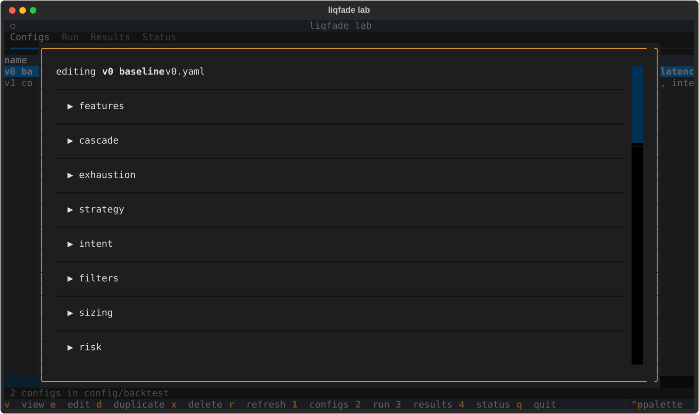
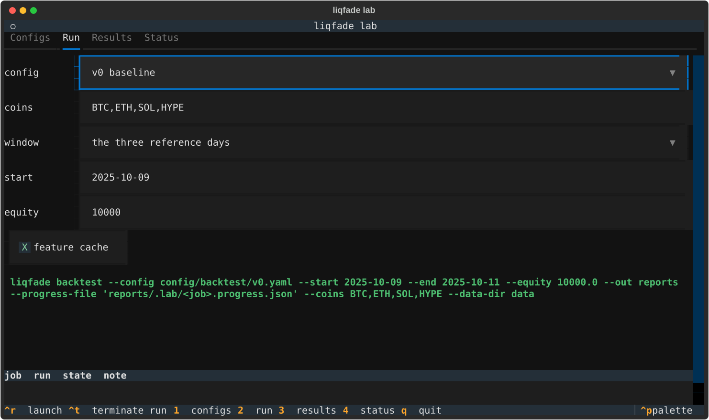
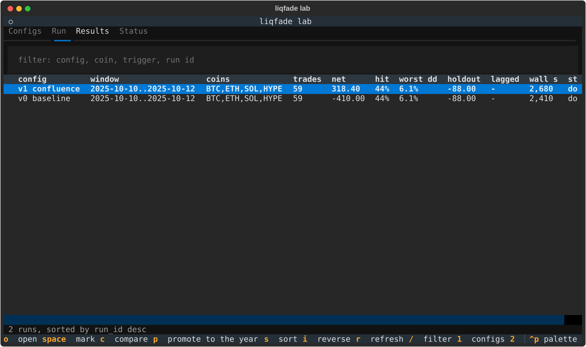
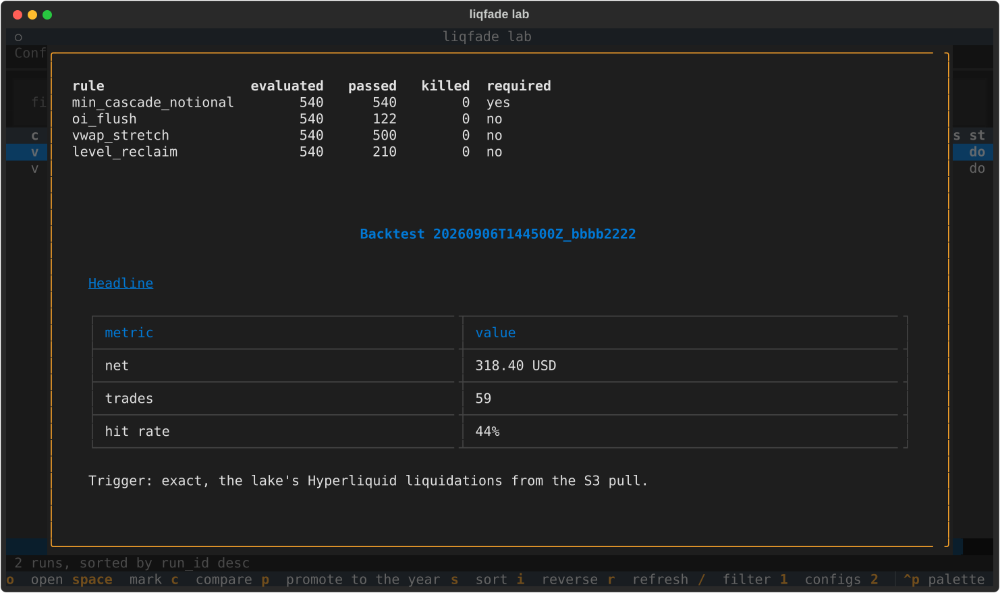
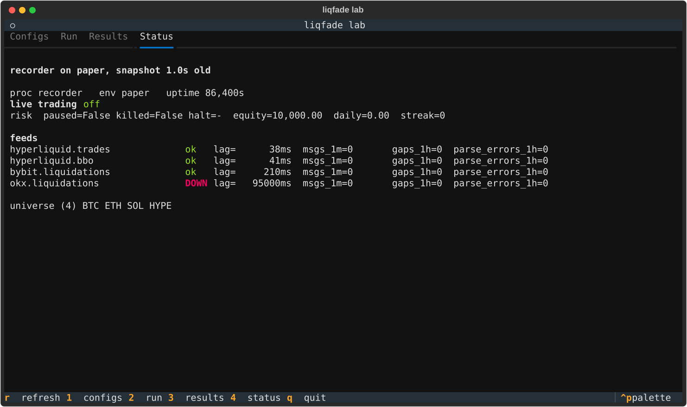

# `liqfade lab`

A terminal workbench for backtests. Four tabs: manage strategy configs, launch runs and
watch them, read and compare the results, and see what the box is doing. It works on the
laptop and over SSH on the VPS, because it is a terminal program with real widgets rather
than a web page.

    uv run liqfade lab

It opens on Configs. Every action has a key and the footer always shows the keys for the
tab you are on. `1` `2` `3` `4` switch tabs, `q` quits.

## What it is, and what it deliberately is not

The lab is a **client of the CLI and of the files the CLI writes**. It never imports the
engine to run a replay: it spawns `liqfade backtest` as a subprocess in its own session.
Two things follow, and both are the reason for the design:

- a crash in the lab cannot take a run down, and closing the lab leaves the run going;
- a run started by hand in another terminal is visible to the lab and holds its queue.

Nothing in the lab can start live trading, and it will not write `config/default.yaml`,
`config/{paper,testnet,mainnet}.yaml` or `config/overrides.yaml`: those are the loader's
layers and a save aimed at one is refused by name. The Status tab only ever reads
`data/state.json`; it does not open the control socket.

**One lake job at a time.** The queue starts a run only when none of its own is running
*and* `pgrep -f "liqfade backtest"` finds nothing. On 8 GB, two replays over the year do not
fit, and the run you did not start is usually the one you care about.

## Configs

Lists `config/backtest/*.yaml`. The name comes from a `# name:` header line and falls back
to the filename; `# notes:` is the one-line why. Both are comments, so the loader ignores
them and a hand-written file without them still lists.

| key | does |
|---|---|
| `v` | view: every overridden key against the resolved default, with the model's description |
| `e` | edit: the form |
| `d` | duplicate under a new name |
| `x` | delete, asked twice |
| `r` | reread the directory |

### The form

The form is **walked out of the `Settings` model**, not listed: a knob added to
`liqfade/config/models.py` appears here on the next start with no change to the lab, and
`tests/test_lab_form.py` pins that. Each field carries the model's own description and is
validated by the model on save, so an invalid value shows the validator's message in red
and writes nothing.

Sections shown are the ones a backtest reads: `features`, `cascade`, `exhaustion`,
`intent`, `strategy` (including `strategy.rules`), `filters`, `sizing`, `risk`, `backtest`.
`venues`, `paths`, `execution`, `control`, `panel`, `telegram` and `sync` are not editable
here: they configure processes the lab does not run.

`ctrl+s` saves, `escape` leaves the file alone.

**An empty box means the key is not in the file**, so it keeps the default, and clearing a
box is how a key is removed. A null override is spelled `null` and is shown as `null`, which
is what `cascade.liq_z_min: null` needs: null is a value the file states, not the absence of
one.

The writer emits every key the file already had, plus any whose value now differs from the
resolved default, each with the model's description above it and the name and notes header
on top, so a saved file reads like the two written by hand. A key that matches the default
is kept when the file already carried it: the file records what the owner chose, and is not
a diff against whatever `config/default.yaml` says next month.

## Run

Pick a config, coins, a window, equity, latency and whether to add the lagged rerun. The
window presets are the three reference days (2025-10-09 to 2025-10-11), the last 7, 30 and
90 days of whatever the lake actually holds, and the year (2025-09-01 to 2026-08-30). Any
of them can be overtyped in the start and end boxes.

Coins are the core four by default, or any typed comma list. An empty box means the core
universe and leaves `--coins` off the command entirely. There is no `universe` option yet
because the engine does not have one: see the note on a day-by-day universe in
`docs/DECISIONS.md`, 2026-09-06.

The **resolved command is shown before anything is spawned**, in the form it will be run.
Latency is spelled as the loader's env override rather than a flag, because
`liqfade backtest` has no `--latency` and does not need one: `LIQFADE_BACKTEST__LATENCY_MS`
goes through the same layering and the same validation as a YAML key.

| key | does |
|---|---|
| `ctrl+r` | launch, or queue if the lake is busy |
| `ctrl+t` | SIGTERM the selected run, SIGKILL it if it ignores that for 10s |

The progress panel calls `liqfade/backtest/watch.py`'s `render`, so the lab and
`liqfade watch` draw the same frame and cannot disagree about a run.

## Results

Every directory under `reports/`, read from its `summary.json`.

| key | does |
|---|---|
| `o` | open `report.md`, with the per-rule funnel above it |
| `space` | mark a run; the last two marked are the pair |
| `c` | the pair side by side, then the diff of their configs |
| `p` | promote: the same config and coins over the year |
| `s` `i` | cycle the sort column, reverse it |
| `/` | filter by config, coin, trigger, run id or window |
| `r` | reread `reports/` |

## Status

Read-only. `data/state.json`, redrawn once a second: which process is up, its feeds and
their lag, positions, orders, risk and latency. On the laptop it is normally empty and says
so. A snapshot older than 10s is shown anyway and marked stale, because the last thing a
process said before it stopped is usually the interesting part.

## Files the lab writes

Everything is under the reports directory, so nothing new appears in `data/`.

| path | what |
|---|---|
| `reports/.lab/<job>.progress.json` | the run's `--progress-file`, while it runs |
| `reports/.lab/<job>.log` | the run's stdout and stderr, while it runs |
| `<report dir>/run.log` | the same log, moved beside the report when the run ends |
| `<report dir>/lab.json` | which config file the lab launched, its name, notes and overrides |

`lab.json` exists because `summary.json` identifies a run by the hash of its resolved
config, which is right for reproducing it and useless for reading a list. A run started by
hand has no `lab.json`; Results falls back to the config hash and says so when asked to
promote or to diff a config it does not know.

The lagged rerun's net is not in `summary.json` either. `liqfade backtest` prints it, so
the lab reads it back out of `run.log`, and a run without a log simply shows no number
rather than a wrong one.

## Regenerating the screenshots

    uv run python scripts/lab_screenshots.py

It builds a throwaway sandbox and never touches the real lake, reports or data directory.
